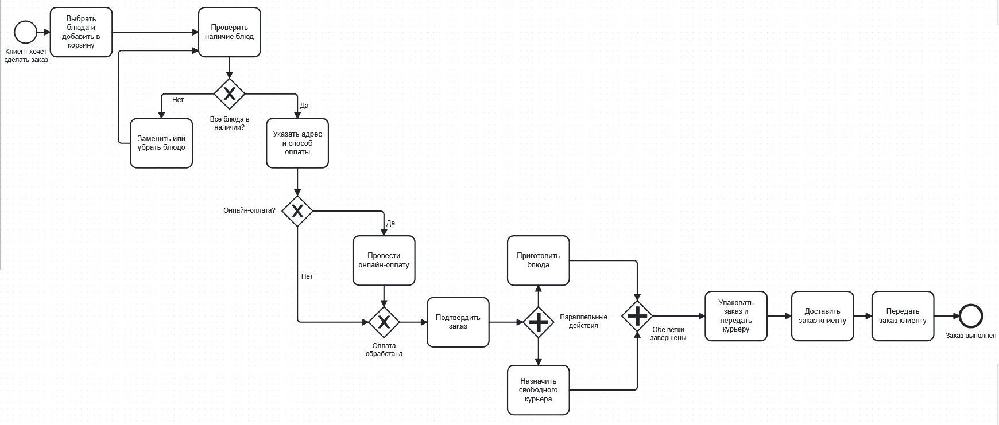
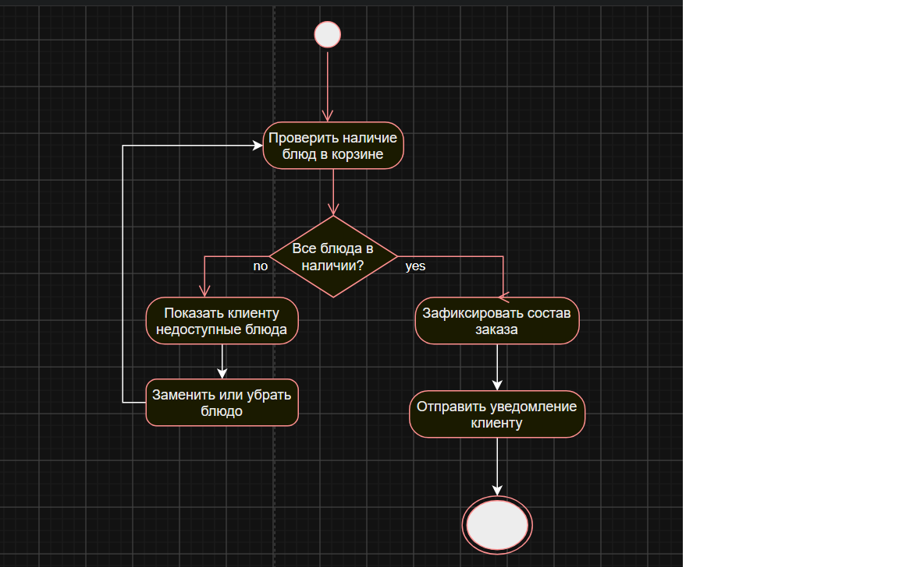
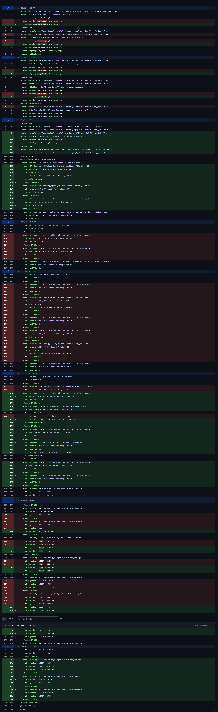
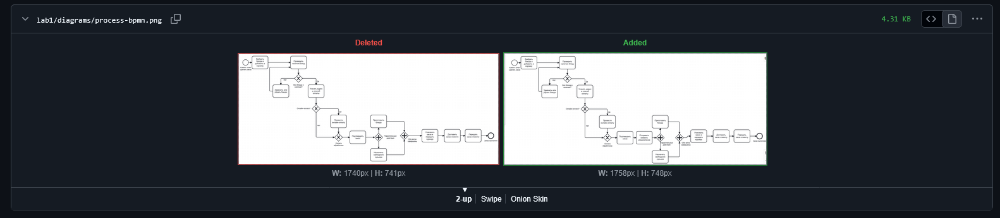

# Отчёт по лабораторной работе №1

## Описание процесса
Я моделировала процесс заказа еды в ресторане с доставкой. 
Клиент выбирает блюда и добавляет их в корзину, затем проверяется наличие блюд. 
Если какого-то блюда нет, клиент заменяет его или убирает, и проверка повторяется. 
Если всё есть, клиент указывает адрес и способ оплаты. Если выбрана онлайн-оплата, 
проводится платёж, иначе этот шаг пропускается. Затем заказ подтверждается и клиенту 
отправляется уведомление. После этого параллельно выполняются два действия: 
приготовление блюд и назначение свободного курьера. Когда обе ветки завершены, 
заказ упаковывают и передают курьеру, он доставляет заказ клиенту, и процесс завершается.
## Диаграммы

### BPMN

### UML Activity

### Sequence
Код: [docs/sequence.md](docs/sequence.md)

### Flowchart
Код: [docs/flowchart.md](docs/flowchart.md)

## Сравнение diff

### BPMN (текстовый XML)

Файл .bpmn хранится как XML-текст, 
поэтому в diff видны конкретные добавленные строки: 
новый элемент и связанные с ним стрелки. Сразу понятно, что именно изменилось.

### PNG (бинарный файл)

Для картинки построчного сравнения нет. 
GitHub показывает только, что файл изменился, а что именно, 
можно понять лишь глазами, сравнивая две картинки.

### Mermaid
Mermaid-файлы текстовые, поэтому diff очень наглядный. 
В flowchart красная строка с доставкой 5 руб заменилась зелёной с 15 руб, 
а в sequence добавилась одна зелёная строка с уведомлением клиенту.

## Выводы
В этой работе я научилась создавать репозиторий, делать коммиты и отправлять их на GitHub,
а также смотреть историю изменений. Я увидела, что текстовые форматы (.bpmn, .drawio, Mermaid) 
удобнее для Git, чем картинки: в них видно, что именно изменилось в каждой строке, 
а в PNG нет. Четыре нотации нужны для разного: BPMN показывает бизнес-процесс целиком, 
UML Activity описывает логику одного шага, Sequence показывает обмен сообщениями между участниками, 
а блок-схема описывает алгоритм расчёта. Хорошие сообщения коммитов помогают потом быстро понять, что и когда менялось.